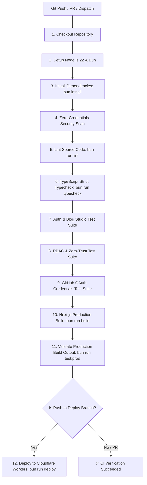

# Cloudflare Workers CI/CD & Deployment Guide — ACM BIT Mesra

Complete documentation for continuous integration, continuous delivery (CI/CD), security validation, environment variables, GitHub Actions secrets, and Cloudflare Workers deployment for the **ACM BIT Mesra Student Developer Platform** on the custom domain `https://acmbitm.campsy.app`.

---

## 1. Architectural Overview

The ACM BIT Mesra platform is an edge-deployed, serverless application built with:
- **Framework:** Next.js 15 (App Router) & React 19
- **Edge Adapter:** OpenNext for Cloudflare (`@opennextjs/cloudflare`)
- **Hosting Platform:** Cloudflare Workers with custom domain routing (`acmbitm.campsy.app`)
- **Database:** Neon Serverless PostgreSQL with Drizzle ORM
- **Authentication:** Better Auth with Google Workspace (@bitmesra.ac.in) & GitHub Developer Integration
- **Package Manager & Runtime:** Bun v1.2+ & Node.js 22 LTS

Every deployment packages server functions into `.open-next/worker.js` and delivers static assets directly to Cloudflare's global edge network via Cloudflare Assets binding.

---

## 2. GitHub Actions Secrets Reference

Automated CI/CD requires configuring repository secrets in GitHub.

> **Location:** Go to **GitHub Repository** → **Settings** → **Secrets and variables** → **Actions** → **Repository secrets**.

### Mandatory Secrets Inventory

| Secret Name | Required By | Description & Source |
| :--- | :---: | :--- |
| `CLOUDFLARE_API_TOKEN` | Wrangler Deploy | Cloudflare User API Token with Worker deployment permissions. |
| `CLOUDFLARE_ACCOUNT_ID` | Wrangler Deploy | 32-character hexadecimal Account ID from Cloudflare Dashboard. |
| `DATABASE_URL` | Build & Test | Connection string for Neon Serverless PostgreSQL (`postgresql://...`). |
| `BETTER_AUTH_SECRET` | Build, Test & Auth | 32+ character cryptographic secret key for signing session tokens. |
| `BETTER_AUTH_URL` | Auth Service | Canonical application URL: `https://acmbitm.campsy.app`. |
| `PUBLIC_SITE_URL` | SEO & Metadata | Public domain URL: `https://acmbitm.campsy.app`. |
| `ADMIN_EMAIL_ALLOWLIST` | RBAC Bootstrap | Comma-separated allowlist of superadmin emails (e.g. `acm@bitmesra.ac.in,Btech10574.24@bitmesra.ac.in`). |
| `ALLOWED_STUDENT_EMAIL_DOMAIN` | Policy Engine | Institutional student domain restriction: `bitmesra.ac.in`. |
| `GOOGLE_CLIENT_ID` | Google OAuth | Google Cloud Console OAuth 2.0 Web Client ID. |
| `GOOGLE_CLIENT_SECRET` | Google OAuth | Google Cloud Console OAuth 2.0 Client Secret. |
| `GH_CLIENT_ID` | GitHub Integration | GitHub OAuth / Developer App Client ID. *(Note: Must use `GH_` prefix as GitHub reserves `GITHUB_`)*. |
| `GH_CLIENT_SECRET` | GitHub Integration | GitHub OAuth / Developer App Client Secret. |
| `GH_REDIRECT_URI` | GitHub Integration | OAuth callback: `https://acmbitm.campsy.app/api/integrations/github/callback`. |

> [!NOTE]
> **GitHub Secret Naming Restriction:** GitHub Actions explicitly disallows repository secrets starting with `GITHUB_` (HTTP 422). For GitHub OAuth variables, the workflow uses `GH_CLIENT_ID`, `GH_CLIENT_SECRET`, and `GH_REDIRECT_URI`, which are automatically mapped to `GITHUB_CLIENT_ID`, `GITHUB_CLIENT_SECRET`, and `GITHUB_REDIRECT_URI` during CI execution.

---

## 3. Provisioning Cloudflare API Credentials

### Creating the Cloudflare API Token
1. Log in to the [Cloudflare Dashboard](https://dash.cloudflare.com/profile/api-tokens).
2. Click **Create Token** → Select **Create Custom Token** (or use the *Edit Cloudflare Workers* template).
3. Assign the following permissions:
   - **Account** → **Workers Scripts** → **Edit**
   - **Account** → **Account Settings** → **Read**
   - **Zone** → **Workers Routes** → **Edit** (or Zone DNS: Read)
4. Set **Account Resources** to **Include** → *Your Account*.
5. Complete creation and copy the API Token. Set it as `CLOUDFLARE_API_TOKEN` in GitHub Secrets.

### Finding Your Cloudflare Account ID
1. Navigate to the Cloudflare Dashboard home or select your domain.
2. In the right-hand sidebar under **API**, copy the **Account ID**.
3. Or find it via the CLI:
   ```bash
   bun x wrangler whoami
   ```
4. Set it as `CLOUDFLARE_ACCOUNT_ID` in GitHub Secrets.

---

## 4. The CI/CD Pipeline (`.github/workflows/deploy.yml`)

The repository runs a unified continuous integration and deployment pipeline on every push and pull request.



### Pipeline Quality Gates:
1. **Zero-Credentials Scanner (`bun run security:scan`):** Scans all files against high-entropy credential patterns and known API tokens to guarantee zero committed secrets.
2. **ESLint (`bun run lint`):** Enforces React 19 and Next.js 15 rules with 0 warnings/errors.
3. **Typecheck (`bun run typecheck`):** Strict TypeScript compilation with zero suppressed errors.
4. **Auth & Blog Suite (`bun run test:auth`):** Verifies Better Auth session verification, role hierarchies, and BlockNote post publishing safeguards.
5. **Security Suite (`bun run test:security`):** Verifies RBAC anti-privilege escalation, IP spoofing protections, audit log sanitization, and Neon database auditing.
6. **GitHub Integration Suite (`bun run test:github`):** Validates GitHub OAuth credentials and token negotiation against live endpoints.
7. **Production Validator (`bun run test:prod`):** Validates all generated HTML routes, JSON-LD structured metadata, and sitemaps.
8. **Cloudflare Deployment (`bun run deploy`):** Packages OpenNext edge worker and publishes directly to Cloudflare edge under domain `acmbitm.campsy.app`.

---

## 5. Local Deployment Instructions

Maintainers can also deploy directly from the local terminal using Bun and Wrangler:

### Step 1: Ensure Local Environment Configuration
Ensure your `.env` contains valid credentials:
```bash
cp .env.example .env
# Fill in DATABASE_URL, BETTER_AUTH_SECRET, GOOGLE_*, GITHUB_*
```

### Step 2: Authenticate Wrangler
```bash
# Log in via browser OAuth:
bun x wrangler login

# Or export your API token:
export CLOUDFLARE_API_TOKEN="your-cloudflare-api-token"
export CLOUDFLARE_ACCOUNT_ID="your-cloudflare-account-id"
```

### Step 3: Run Full Verification Suite
```bash
bun run test
```

### Step 4: Deploy to Cloudflare Workers
```bash
bun run deploy
```
This runs `next build`, builds the OpenNext bundle via `opennextjs-cloudflare build`, and uploads the worker with `OPEN_NEXT_DEPLOY=true wrangler deploy`.

---

## 6. Cloudflare Worker Secrets Management

In addition to GitHub Secrets (which power build-time compilation and CI tests), runtime environment secrets must be registered with Cloudflare Workers so the live edge worker can access them:

```bash
# Provision runtime database connection
bun x wrangler secret put DATABASE_URL

# Provision authentication secret
bun x wrangler secret put BETTER_AUTH_SECRET

# Provision OAuth credentials
bun x wrangler secret put GOOGLE_CLIENT_ID
bun x wrangler secret put GOOGLE_CLIENT_SECRET
bun x wrangler secret put GITHUB_CLIENT_ID
bun x wrangler secret put GITHUB_CLIENT_SECRET

# Provision admin policy variables
bun x wrangler secret put ADMIN_EMAIL_ALLOWLIST
bun x wrangler secret put ALLOWED_STUDENT_EMAIL_DOMAIN
```

---

## 7. Custom Domain Verification

The worker route is configured in `wrangler.jsonc`:
```jsonc
{
  "$schema": "node_modules/wrangler/config-schema.json",
  "name": "acm-bitmesra",
  "main": ".open-next/worker.js",
  "compatibility_date": "2025-02-14",
  "compatibility_flags": ["nodejs_compat"],
  "assets": {
    "directory": ".open-next/assets",
    "binding": "ASSETS"
  },
  "routes": [
    {
      "pattern": "acmbitm.campsy.app",
      "custom_domain": true
    }
  ]
}
```

Cloudflare automatically creates DNS records and issues an edge SSL/TLS certificate.

To verify production health after deployment:
```bash
# Check HTTP status of public student profile
curl -sI https://acmbitm.campsy.app/u/sh20raj

# Check HTTP status of event rankings
curl -sI https://acmbitm.campsy.app/events/hacktoberfest-2026/rankings

# View live real-time tail logs
bun x wrangler tail
```

---

## 8. Rollback Procedure

If a deployed version experiences unexpected issues:
1. Open the [Cloudflare Dashboard](https://dash.cloudflare.com) → **Workers & Pages** → **`acm-bitmesra`**.
2. Click on the **Deployments** tab.
3. Locate the previous stable version ID (e.g. `ed65cb9c-93f6-4a1c-a0ac-9ca6dd509f90`).
4. Click **•••** (Options) → **Rollback to this deployment**.
5. The edge route `acmbitm.campsy.app` reverts instantly with zero downtime.
