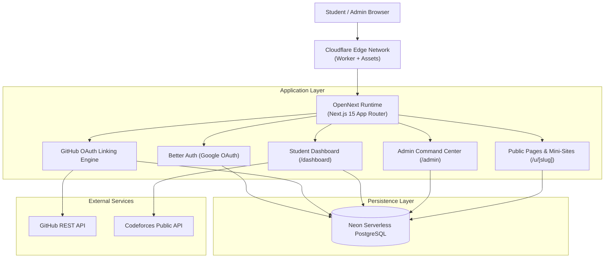
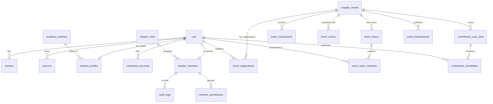

# ACM BIT Mesra Student Developer Platform — Architecture Specification

---

## 1. High-Level System Architecture



---

## 2. Database Entity Relationship Diagram (ERD)



---

## 3. Authentication & Account Linking Sequences

### University Login vs. GitHub Account Connection

1. **University Authentication (`@bitmesra.ac.in`)**:
   - Provider: Google OAuth via Better Auth.
   - Purpose: Primary identity authentication.
   - Gate: Normalized email domain must strictly equal `bitmesra.ac.in`.
   - Access: Grants access to the Student Dashboard and student features. Does **not** grant administrative roles.

2. **GitHub Account Connection (OAuth Linking)**:
   - Provider: GitHub OAuth App.
   - Purpose: Cryptographic proof of GitHub ownership for contribution tracking.
   - Flow:
     ```mermaid
     sequenceDiagram
         autonumber
         actor S as Student
         participant D as /dashboard/settings
         participant API as /api/integrations/github
         participant GH as GitHub OAuth
         participant DB as Neon Database

         S->>D: Clicks "Connect GitHub"
         D->>API: GET /connect (Authenticated session)
         API->>API: Generate random state & set secure HttpOnly cookie
         API-->>S: 302 Redirect to GitHub OAuth Authorization
         S->>GH: Authorizes ACM BIT Mesra read-only scope
         GH-->>API: GET /callback?code=...&state=...
         API->>API: Validate state against cookie
         API->>GH: Exchange code for OAuth access token
         API->>GH: GET /user (Fetch authenticated user details)
         API->>DB: Check if GitHub ID already linked to another student
         alt Already Linked to Another Account
             API-->>S: Redirect with error: "GitHub account is already linked"
         else Unique & Valid
             API->>DB: Insert/Update connected_accounts (numeric ID, login, URLs)
             API->>DB: Record audit_log (GITHUB_ACCOUNT_LINKED)
             API-->>S: Redirect to /dashboard/settings with success notification
         end
     ```

---

## 4. Edge Deployment Architecture

- **Host**: Cloudflare Workers with OpenNext (`opennextjs-cloudflare`).
- **Dynamic Routing**: Server-rendered API routes and Admin console execute in the Cloudflare V8 worker sandbox with `nodejs_compat`.
- **Static Assets**: Exported Next.js client bundles, images, and fonts are served via Cloudflare Workers Assets.
- **Custom Domain**: Bound to `acmbitm.campsy.app` via Cloudflare Custom Domains.
