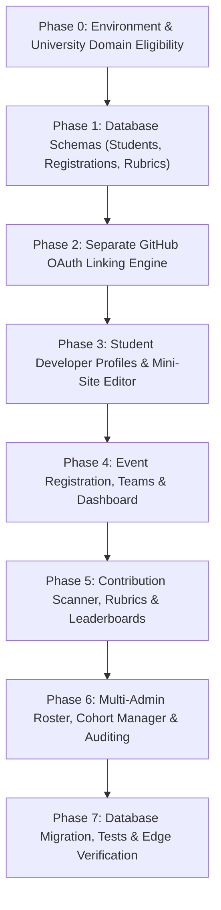

# ACM BIT Mesra Student Developer Platform — Master Implementation Plan

Target Repository: `https://github.com/acm-bitmesra/acm-bitmesra.github.io`  
Production Target: `https://acmbitm.campsy.app/`  
Status: **In Progress**  
Branch: `feat/student-developer-platform`

---

## 1. Executive Summary & Architectural Objective

The goal of this initiative is to evolve the official ACM BIT Mesra web application from an editorial chapter website into a high-scale, database-driven **Student Developer Platform**.

Key Capabilities:
1. **Verified University Identity**: Restricted sign-in allowing all students with verified `@bitmesra.ac.in` addresses to authenticate securely while preserving strict admin/moderator governance.
2. **Student Developer Profiles & Mini-Sites**: Public profiles (`/u/[slug]`) and modular portfolios showcasing skills, verified GitHub accounts, competitive coding ratings (Codeforces, LeetCode), and achievements.
3. **Independent GitHub Account Linking**: Secure OAuth flow to prove ownership of GitHub accounts independently from university login credentials, protected with CSRF/state tokens and token encryption.
4. **Event Management, Registration & Teams**: Dynamic database-driven events with capacity constraints, internal/external workflows, team formation with join codes, attendee check-ins, and participant history.
5. **ACM Contribution Challenges (Hacktoberfest & Beyond)**: Configurable contribution scanners for public repository pull requests, human-in-the-loop moderation, rubric-based scoring, tie-breaking, and snapshot leaderboards.
6. **Multi-Admin RBAC & Anti-Escalation**: Role-based permissions (`SUPER_ADMIN`, `ADMIN`, `EVENT_MANAGER`, `MODERATOR`, `CONTENT_EDITOR`, `VIEWER`, `STUDENT`) with tamper-evident audit logging and database-backed batch/cohort management.
7. **Database-Driven Institutional Content**: Complete migration of mutable events, news, teams, cohorts, and resources from hardcoded TypeScript files into PostgreSQL with Cloudflare Worker edge delivery.

---

## 2. Implementation Phases & Vertical Slices

### Phase 0: University Identity Verification & Auth Extension
- [x] Audit Better Auth setup in `src/lib/auth/auth.ts` and `src/lib/auth/session.ts`.
- [x] Implement strict domain verification (`isBitMesraStudentEmail`) rejecting lookalikes (e.g. `user@bitmesra.ac.in.evil.com`).
- [x] Decouple general student authentication from administrative chapter roles.
- [x] Protect unauthorized Google accounts with informative error states.

### Phase 1: Database Schemas & Migrations
- [ ] Create `src/db/schema/students.ts`:
  - `student_profiles`
  - `academic_batches`
  - `connected_accounts`
- [ ] Create `src/db/schema/event-registrations.ts`:
  - `event_registrations`
  - `event_teams`
  - `event_team_members`
  - `event_submissions`
  - `event_rubrics`
  - `contribution_scan_jobs`
  - `contribution_candidates`
  - `event_leaderboards`
- [ ] Export in `src/db/schema/index.ts`.
- [ ] Generate Drizzle migrations and ensure backward compatibility.

### Phase 2: Independent GitHub Account Linking
- [ ] Route `/api/integrations/github/connect`: CSRF state generation and OAuth redirect.
- [ ] Route `/api/integrations/github/callback`: Server-to-server code exchange, GitHub API verification, unique constraint enforcement.
- [ ] Route `/api/integrations/github/disconnect`: Revocation and unlink workflow.
- [ ] Route `/api/integrations/github/sync`: Refresh public repository metadata and contribution facts.
- [ ] Safe token encryption layer (`src/lib/security/encryption.ts`).

### Phase 3: Developer Profiles & Personal Mini-Sites
- [ ] Route `/u/[slug]`: Public developer profile and portfolio page.
- [ ] Mini-site editor in `/dashboard/profile`:
  - Intro, about, skills, projects, verified accounts, event achievements.
  - Markdown content sanitization (`rehype-sanitize`).
- [ ] External accounts registry: Codeforces handle verification via official API (`https://codeforces.com/api/user.info`), LeetCode, GitLab, DEV.to, and portfolio links.

### Phase 4: Event Registration, Teams & Student Dashboard
- [ ] Route `/dashboard`: Unified student command center.
- [ ] Route `/api/events/[slug]/register`: Atomic capacity checks, duplicate prevention, and waitlists.
- [ ] Team management: Team creation, join code generation, member limits, and locked team states.
- [ ] Submission tracking and student event participation history.

### Phase 5: Hacktoberfest & Contribution Evaluation Engine
- [ ] Independent ACM BIT Mesra challenge scoring engine.
- [ ] Configurable candidate discovery across registered students' connected GitHub accounts.
- [ ] Reviewer moderation dashboard: approve/reject, reason-required score adjustments, rubric versioning.
- [ ] Snapshot leaderboard generator with deterministic tie-breaking.
- [ ] Event data export API (CSV and JSON) with permission scoping and audit records.

### Phase 6: Multi-Admin RBAC, Batch Manager & Audit Logs
- [ ] Hierarchical RBAC (`SUPER_ADMIN` down to `STUDENT`).
- [ ] Admin Cohort / Batch Manager (`/admin/batches`).
- [ ] Admin Event Operations & Registration Desk (`/admin/events/[id]/registrations`).
- [ ] Tamper-evident, append-only audit logging for all mutations.
- [ ] Zero-Trust anti-escalation guards preventing self-promotion.

### Phase 7: Verification, Database Parity & Production Deployment
- [ ] Verify TypeScript compilation (`bun run typecheck`).
- [ ] Verify ESLint compliance (`bun run lint`).
- [ ] Run production validation (`node scripts/validate-production.mjs`).
- [ ] Run auth and security test suites.
- [ ] Build Cloudflare Worker bundle with OpenNext.
- [ ] Deploy and verify live operation on `https://acmbitm.campsy.app`.
